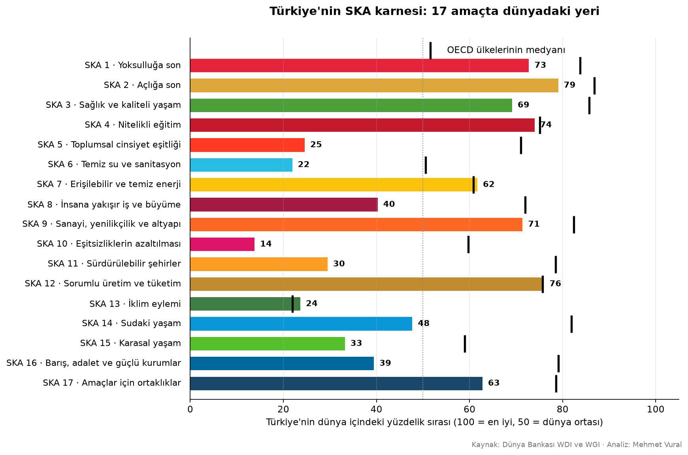
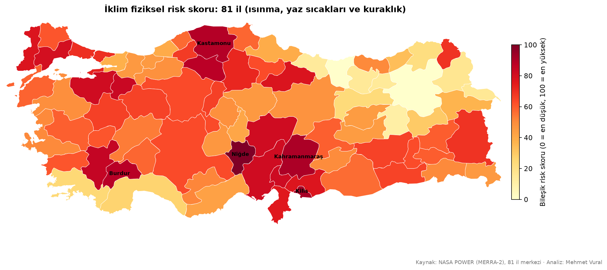
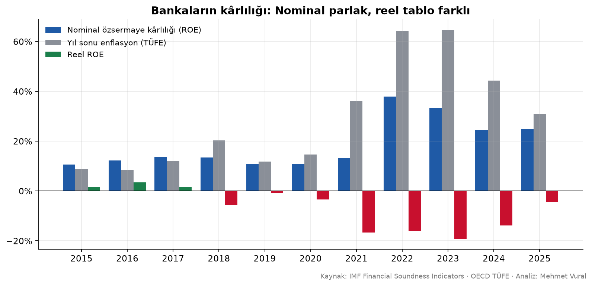
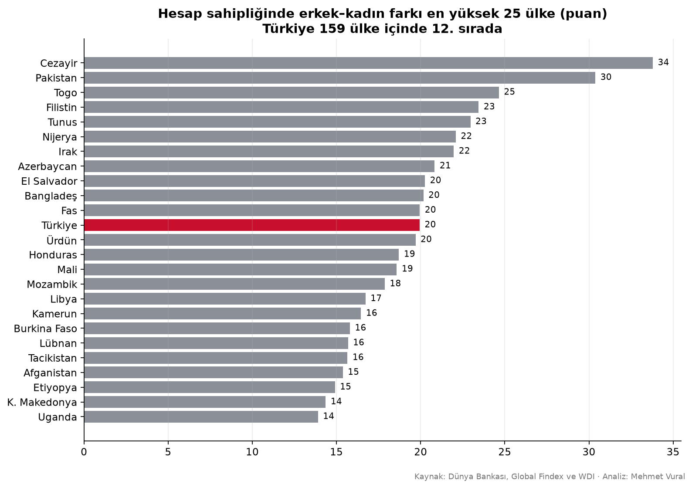

# 🌍 Veriyle Sürdürülebilir Kalkınma


Türkiye'yi **BM Sürdürülebilir Kalkınma Amaçları (SKA)** üzerinden finans ve veri bilimi gözüyle inceleyen **15 analizlik** bir seri. Her analiz, resmî bir SKA göstergesini açık ve güvenilir veriyle ölçüyor; sonuçlar Medium'da makale olarak yayımlanıyor.

**İlke:** Bütün sayılar kodla üretilir ve tekrarlanabilir. Varsayım içeren analizlerde (⚠️) varsayımlar açıkça belirtilir ve duyarlılık analizi yapılır.

---

## Analizler

| # | Analiz | SKA göstergesi | Öne çıkan bulgu | Veri |
|---|---|---|---|---|
| 03 | [Finansal kapsayıcılık](analiz/03_finansal_kapsayicilik.py) | **8.10.2**, 8.10.1 | Her 5 yetişkinden birinin hesabı yok; kadın-erkek farkında Türkiye 159 ülke içinde 12. | Global Findex 2024 |
| 04 | [Türkiye'nin SKA karnesi](analiz/04_ska_karnesi.py) | 17 amaç, 30 gösterge | Temel ihtiyaçlarda güçlü, eşitsizlik (14/100) ve kurumlarda zayıf | Dünya Bankası WDI, WGI |
| 05 | [Konya'da güneş enerjisi yatırımı](analiz/05_konya_gunes.py) ⚠️ | 7.2.1 | 1 kWp panel Berlin'in %49 fazlası üretiyor; 5 kWp sistem ~7 yılda geri dönüyor | AB PVGIS |
| 06 | [Konya Havzası'nda kuraklık](analiz/06_konya_kuraklik.py) | 6.4.2, 2.4, 13.1 | Yağış azalmıyor, ama 45 yılda +1,7 °C; 2025 kayıtların en büyük su açığı | NASA POWER |
| 07 | [Bankacılığın finansal sağlamlığı](analiz/07_bankacilik.py) | **10.5.1** | Reel ROE 2018'den beri negatif; takipteki krediler 8 çeyrektir artıyor | IMF FSI |
| 08 | [Enerji dönüşümü ve emisyonlar](analiz/08_enerji_emisyon.py) | 7.2.1, 9.4.1, 13.2 | Güneş 5 yılda 3,3 kat; kişi başı CO₂ AB ortalamasının üstünde; Kaya ayrıştırması | Our World in Data |
| 09 | [Gıda enflasyonu ve fiyat anomalileri](analiz/09_gida_enflasyonu.py) | **2.c.1** | Gıda 20 yılda 42,5 kat; 2021–2025'in %58'i "anormal" fiyat dönemi | OECD, FAO |
| 10 | [Kadınların işgücüne katılımı](analiz/10_kadin_isgucu.py) | 5.5.1, **5.5.2**, 8.5.2, 8.6.1 | 177 ülke içinde 151.; OECD medyanına ulaşmak 6,3 milyon kadın demek | Dünya Bankası / ILO |
| 11 | [Gelir eşitsizliği](analiz/11_esitsizlik.py) | **10.1.1**, **10.2.1** | OECD'nin en eşitsiz 3. ülkesi; Palma oranı 2,26 | Dünya Bankası PIP |
| 12 | [Yaşlanma ve emeklilik](analiz/12_yaslanma.py) | 1.3 | 65+ payı %10'dan %20'ye 23 yılda; bir yaşlıya düşen çalışan 3,7 → 1,9 | BM nüfus projeksiyonları |
| 13 | [Firmaların krediye erişimi](analiz/13_kobi_kredi.py) | **9.3.2**, 8.3 | Banka kredisi olan firma oranı %57'den (2008) %26'ya (2024) | İşletme Anketleri |
| 14 | [SKDM (sınırda karbon) maruziyeti](analiz/14_skdm.py) ⚠️ | 13.2, 17.11 | AB'ye 12,5 mlr $ kapsamdaki ihracat; çimentoda karbon maliyeti ürün değerini aşabilir | BM Comtrade |
| 15 | [Deprem riski ve sigorta açığı](analiz/15_deprem_sigorta.py) | 1.5.2, 11.5 | Konutların %56'sı sigortalı; 2023'te sigorta konut hasarının ~%8'ini karşıladı | USGS, DASK, Dünya Bankası |
| 16 | [İklim stres testi](analiz/16_iklim_stres.py) ⚠️ | 13.1 | 81 ilin iklim risk skoru; temsilî portföyde kuraklık beklenen kaybı %13–54 artırıyor | NASA POWER (81 il) |
| 17 | [Hava kirliliği](analiz/17_hava_kirliligi.py) | **11.6.2**, 3.9.1 | Yerleşimlerin %99'u DSÖ sınırının üstünde; 3 göstergede OECD'nin en kötüsü | DSÖ (Haziran 2026) |

**Kalın** gösterge kodları, analizin resmî SKA göstergesini doğrudan ölçtüğünü gösterir. ⚠️ işaretli analizlerde temsilî varsayımlar vardır.

## Seçilmiş grafikler

<p align="center">
  
  
</p>
<p align="center">
  
  
</p>

## Yöntemler

Lojistik/doğrusal regresyon · LMDI (Kaya) ayrıştırması · gama dağılımıyla SPI kuraklık indeksi · Thornthwaite evapotranspirasyon · Mann–Kendall eğilim testi · NBD/İVO/LCOE yatırım analizi · beklenen kayıp (PD × LGD × EAD) stres testi · FAO IFPA anomali göstergesi · yüzdelik sıra karnesi · nokta-çokgen eşleştirmesiyle mekânsal analiz

## Çalıştırma

```bash
pip install -r requirements.txt
cd analiz
python veri_indir.py        # depoya konmayan büyük dosyaları (OWID, DSÖ) indirir
python 03_finansal_kapsayicilik.py   # her betik grafiklerini gorseller/ klasörüne yazar
```

Diğer veriler `veri/` klasöründe hazır. Dünya Bankası verileri ilk çalıştırmada API'den çekilip önbelleğe alınıyor.

## Yapı

```
├── analiz/      # Her analiz için bir Python betiği + ortak.py (grafik stili, veri yardımcıları)
├── veri/        # İndirilmiş ve önbelleğe alınmış veriler
└── gorseller/   # Makalelerde kullanılan grafikler
```

## İlgili projeler

- [Kredi Skorlama Modeli](https://github.com/mehmet-vural/kredi-skorlama) · [Enflasyon Tahmini](https://github.com/mehmet-vural/enflasyon-tahmini) · [Enflasyon ve Döviz Analizi](https://github.com/mehmet-vural/enflasyon-doviz-analizi) · [Kredi ve Faiz Hesaplayıcı](https://github.com/mehmet-vural/kredi-faiz-hesaplayici)

> ⚠️ Eğitim ve araştırma amaçlıdır; yatırım veya finansal tavsiye değildir.

---

**Mehmet Vural** · Matematik & İşletme · Veri Bilimi ve Finans · [LinkedIn](https://www.linkedin.com/in/mehmetvrl/) · [Medium](https://medium.com/@mehmetvrl32)
